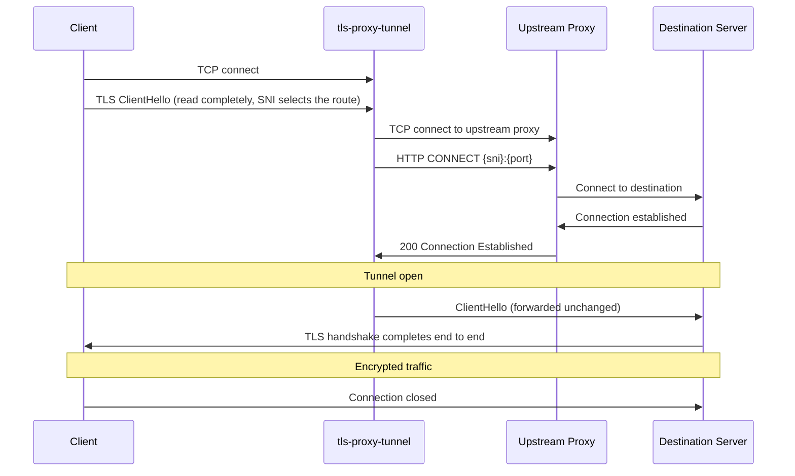

# tls-proxy-tunnel

`tls-proxy-tunnel` (`tpt`) is a layer-4 proxy written in Rust. It listens on
configured ports, reads the TLS ClientHello to route by SNI (without
terminating TLS), and tunnels the connection to a remote address —
optionally via an HTTP CONNECT proxy.

## Features

- Listen on one or more ports and forward TCP connections
- SNI-based routing without terminating TLS
- DNS backend with periodic re-resolution (`tcp://`, `tcp4://`, `tcp6://`)
- HTTP CONNECT tunnelling with configurable headers and timeout (`via`)
- Environment-variable substitution in header values (`$VARNAME`)
- Per-server connection limit (`maxclients`)
- Timeouts against stuck clients and proxies (`client_hello_timeout`,
  `connect_timeout`, `idle_timeout`) and TCP keepalive on every connection
- Prometheus metrics endpoint (`/metrics`)
- Built-in upstreams: `ban`, `echo`, `health`
- JSON or plain-text log format; log level configurable per config or `RUST_LOG`

## Sequence diagram



## Installation

Build from source (requires [Rust toolchain](https://rustup.rs/)):

```bash
cargo build --release
# binary: target/release/tls-proxy-tunnel
```

Install from a checkout with Cargo (the crate is not published on crates.io):

```bash
cargo install --path .
```

Or download a pre-built binary (amd64, arm64; static musl) from the
[Releases page](https://github.com/git001/tls-proxy-tunnel/releases).

## Usage

```
tpt [OPTIONS]

OPTIONS:
    -c, --config <path>    Path to config file
    -h, --help             Show this help
```

When `--config` is not given, `tpt` searches for a config file in this order:

1. `$TPT_CONFIG` environment variable
2. `/etc/tpt/tpt.yaml`
3. `/etc/tpt/config.yaml`
4. `./tpt.yaml`
5. `./config.yaml`

If no arguments are given and no config file is found, the help text is printed.

## Configuration

Config files use YAML and must start with `version: 2` (the tpt 4 format).
Other versions are rejected at startup; for a `version: 1` file, check the
changes listed in the CHANGELOG and set `version: 2`.

Unknown keys are errors, at every level. A typo stops tpt at startup with
the line, the column and the valid names:

```
Could not load config: YAML parse error: error: line 6 column 5: unknown field `client_hello_timout`, expected one of listen, protocol, tls, sni, default, via, maxclients, client_hello_timeout
```

Top-level keys: `version`, `log`, `log-format`, `shutdown_timeout`,
`servers`, `upstream`, and `via` (only as a place for a YAML anchor that
servers reference with `*name`; tpt itself does not read it).

### Minimal example

```yaml
version: 2
log: info

servers:
  proxy_server:
    listen:
      - "0.0.0.0:8443"
    tls: true
    sni:
      www.example.com: corp_proxy
    default: ban
    maxclients: 100
    via:
      use_sni_as_target: true
      target_port: 443
      connect_timeout: 30s

  health_server:
    listen:
      - "127.0.0.1:8080"
    default: health

upstream:
  corp_proxy: "tcp://proxy.internal:3128"
```

### Server reference

```yaml
servers:
  my_server:
    listen:                      # one or more addresses
      - "0.0.0.0:8443"
    protocol: tcp                # tcp | tcp4 | tcp6 (default: tcp)
    tls: true                    # read the TLS ClientHello, route by SNI
    sni:                         # SNI → upstream (see the via reference)
      www.example.com: corp_proxy
    default: ban                 # upstream when no SNI matches (default: ban)
    maxclients: 100              # concurrent connections (default: 100)
    client_hello_timeout: 10s    # TLS: time to send the ClientHello (default: 10s, 0s = no limit)
    via: { ... }                 # HTTP CONNECT settings, see below
```

`client_hello_timeout` bounds clients that connect but send nothing (or send
slowly). Without it, each such client would hold one of the `maxclients`
slots for as long as it stays connected.

The ClientHello is read completely before routing, even when it arrives in
several TCP segments (common today: post-quantum key shares make it larger
than one segment), up to the TLS record maximum of 16 KiB. The bytes are
forwarded to the upstream unchanged, so the TLS session still runs end to
end between client and destination.

#### Listen addresses and startup failures

If any listener cannot be opened (port in use, no permission, …), tpt shuts
down and exits with status 1, so systemd or Kubernetes see the failure.
Errors while accepting a connection (for example `EMFILE`, too many open
files) are not fatal: tpt logs them, pauses 100 ms and accepts again.

On Linux, `[::]:PORT` accepts IPv4 **and** IPv6 (dual-stack, unless
`net.ipv6.bindv6only=1`). Do not list `0.0.0.0:PORT` and `[::]:PORT`
together: the second bind fails with "address in use" and tpt does not start.
Use `[::]:PORT` for both protocols, or `0.0.0.0:PORT` for IPv4 only.

### Full `via` reference

```yaml
via:
  target: "host:port"          # static CONNECT target; ignored when use_sni_as_target: true
  use_sni_as_target: true      # derive CONNECT target from TLS SNI
  target_port: 443             # port appended to SNI (default: 443)
  connect_timeout: 30s         # DNS + TCP connect + CONNECT response (default: 30s, 0s = no limit)
  stats_interval: 30s          # log rx/tx counters every N seconds (default: 0s = off)
  idle_timeout: 5m             # close after no data in either direction (default: 0s = off)
  headers:
    Proxy-Authorization: "Basic $ENCODED_PW"   # $VARNAME resolved from env
    X-Custom-Header: "static-value"
```

`via` can be set at server level (inherited by all SNI entries) or overridden
per SNI entry:

```yaml
sni:
  www.example.com: corp_proxy          # plain string: inherits server via
  intern.corp.org:
    upstream: direct_host
    via: {}                            # via: {} → direct TCP (no CONNECT)
  api.example.com:
    upstream: corp_proxy
    via:                               # per-SNI override
      target: "api.example.com:8443"
      connect_timeout: 10s
```

Every field is optional; a missing field (or a missing `via:` block) takes
the default shown above.

### Timeouts and dead connections

| Setting | Where | Default | Protects against |
|---|---|---|---|
| `client_hello_timeout` | server | 10s | client connects but sends no (or a slow) ClientHello |
| `connect_timeout` | `via` | 30s | slow DNS, unreachable upstream, proxy that never answers CONNECT |
| `idle_timeout` | `via` | off | relayed connections that stay open without any traffic |
| `shutdown_timeout` | top level | 25s | connections that keep a SIGTERM shutdown from finishing |
| TCP keepalive | always on | 60s + 3 × 10s | peer gone without FIN/RST (NAT timeout, cable pulled) |

TCP keepalive is set on both sockets of every relayed connection: the first
probe after 60 s without traffic, then every 10 s, and the connection is
dropped after 3 unanswered probes (~90 s). It needs no privileges.

`idle_timeout` counts traffic in both directions, so a long download with a
silent client stays open. Leave it off for protocols with long quiet phases
(for example idle database or SSH sessions), or set it above their longest
pause.

On SIGTERM or SIGINT tpt stops accepting, lets active connections finish
and exits once they are done, or after `shutdown_timeout` (then it logs how
many it closed). The default of 25 s stays below the 30 s Kubernetes grace
period, so tpt exits on its own before SIGKILL. `0s` waits without limit.

```yaml
version: 2
shutdown_timeout: 25s
```

When the upstream proxy sends data right after its `200` response (a target
that speaks first, such as SSH or SMTP), tpt passes it on to the client.

### Upstream protocols

```yaml
upstream:
  corp_proxy:  "tcp://proxy.internal:3128"    # IPv4 or IPv6
  corp_proxy4: "tcp4://proxy.internal:3128"   # force IPv4
  corp_proxy6: "tcp6://proxy.internal:3128"   # force IPv6
```

### Logging

```yaml
log: info          # off | error | warn | info | debug | trace | disable
log-format: txt    # txt | text | json  (default: txt)
```

`RUST_LOG` takes precedence over the config `log` field.

### Built-in upstreams

| Name | Behaviour |
|------|-----------|
| `ban` | Closes the connection immediately |
| `echo` | Reflects received bytes back to the sender |
| `health` | HTTP/1.1: `GET /health` → `200 OK`, `GET /metrics` → Prometheus text |

### Prometheus metrics

The `health` upstream exposes `/metrics` in Prometheus text format:

```
# HELP tpt_active_connections Current number of active connections
# TYPE tpt_active_connections gauge
tpt_active_connections{name="proxy_server",listen="0.0.0.0:8443"} 3

# HELP tpt_maxclients Maximum number of concurrent connections
# TYPE tpt_maxclients gauge
tpt_maxclients{name="proxy_server",listen="0.0.0.0:8443"} 100
```

## Test run

```bash
TPT_CONFIG=container-files/etc/tpt/config.yaml cargo run
```

## Tests

```bash
cargo test                 # unit tests
tests/vtest/run.sh         # VTest2 integration tests
tests/proxy/squid.sh       # against a real squid (needs podman, openssl, curl)
```

`tests/proxy/squid.sh` builds a local squid image (`tests/proxy/Containerfile`),
runs it on the host network and sends curl through tpt and squid to an
`openssl s_server` backend. It checks a plain CONNECT tunnel, Basic proxy auth
via `$VAR` header, a 407 without credentials, squid as a TLS man in the middle
(ssl-bump) with and without its CA, and the `ban` default for an unknown SNI.
Run `cargo build` first. Inside a flatpak sandbox, use
`flatpak-spawn --host tests/proxy/squid.sh`.

## Container

Multi-arch images (amd64, arm64) are published to
`ghcr.io/git001/tls-proxy-tunnel` for every release tag.

tpt needs no privileges: it runs as any unprivileged user, including the
random UID that OpenShift assigns, as long as the listen ports are above
1024. It writes no files, so a read-only root filesystem works.

### Sizing

Measured with a release build: about **12 MiB** at idle and about **55 KiB
per concurrent connection** (relay buffers, task state), so roughly

```
memory ≈ 12 MiB + 55 KiB × maxclients (all servers) + kernel socket buffers
```

| Concurrent relays | RSS |
|---|---|
| 0 | 12 MiB |
| 100 | 25 MiB |
| 1000 | 67 MiB |

Kernel socket buffers are charged to the container under cgroup v2 and grow
with throughput, so leave headroom. The allocator keeps freed memory for
reuse; RSS stays near its peak after a load spike.

For CPU, set a request and no limit: a CPU limit throttles in bursts (CFS),
which shows up as latency on every relayed connection. tpt sizes its worker
threads to the CPU quota it sees.

[openshift/](openshift/) has a deployment example: ConfigMap with the
config, a Secret with the proxy credentials (`ENCODED_PW`, used as
`Proxy-Authorization: Basic $ENCODED_PW`), and a Deployment with a
`securityContext` that fits the OpenShift `restricted-v2` SCC and the
Kubernetes `restricted` Pod Security level.

## Thanks

- [`fourth`](https://crates.io/crates/fourth), of which this is a heavily modified fork.
- [`layer4-proxy`](https://code.kiers.eu/jjkiers/layer4-proxy)

## License

`tls-proxy-tunnel` is available under the terms of Apache-2.0.
